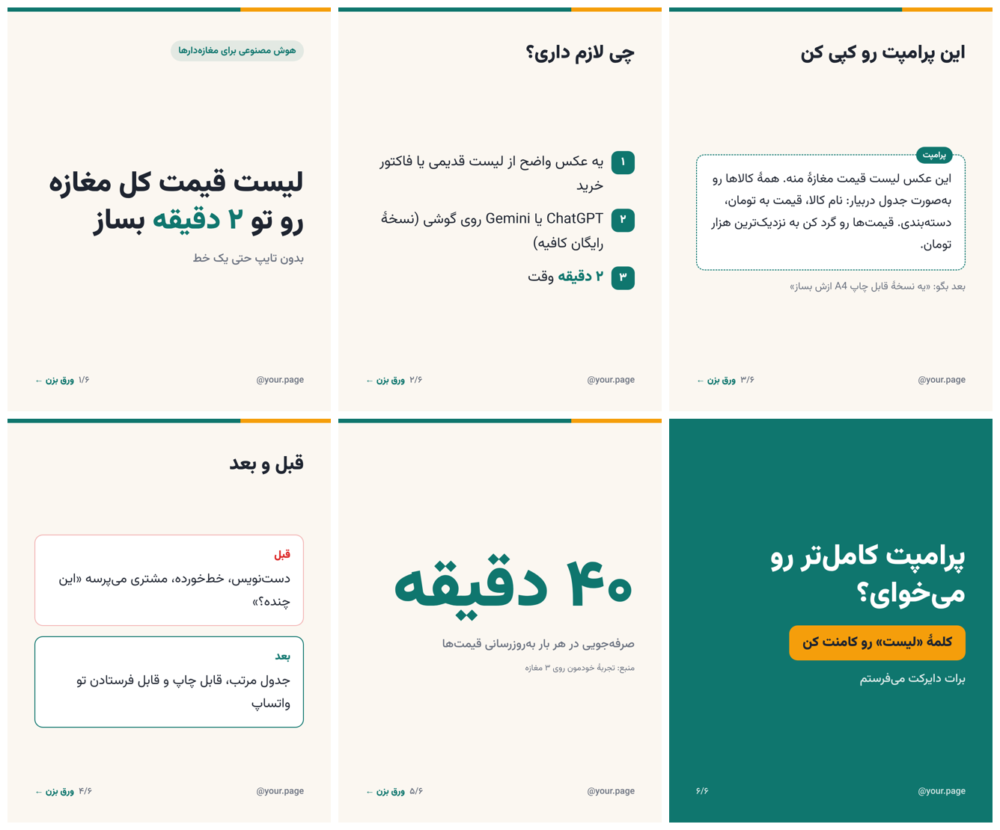
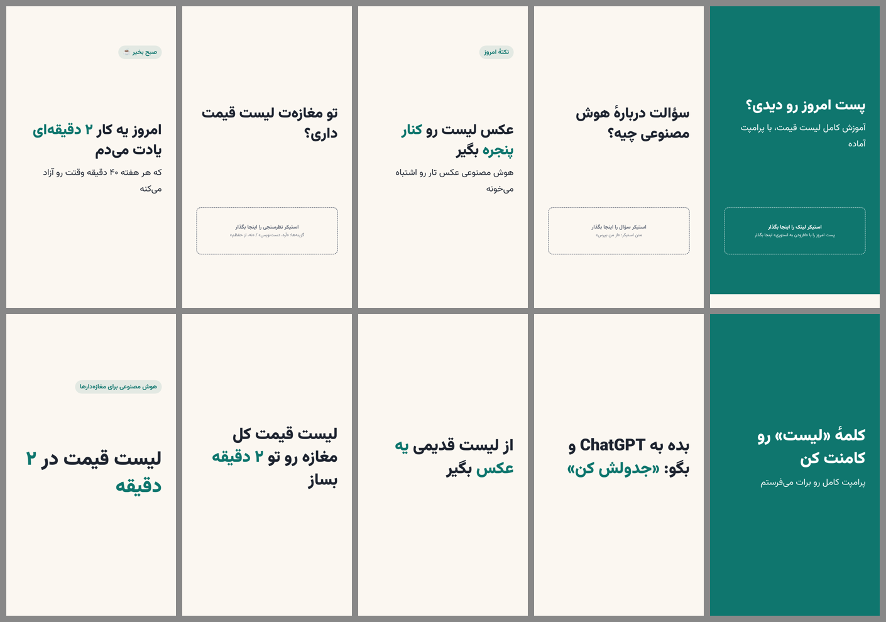

# instagram-fa — بستهٔ فارسی اینستاگرام برای Claude

سیزده اسکیل که یک پیج اینستاگرام فارسی را از صفر تا انتشار جلو می‌برند: شناسنامهٔ پیج، برنامهٔ
هفتگی با اکسل، ساختن کاروسل و استوری و ریلز با تصویر فارسی آماده، کپشن، انسانی‌ساز فارسی، و
یک دروازهٔ تأیید که بدون «بله»ی تو هیچ چیزی را آمادهٔ انتشار نمی‌کند.

**به هیچ موضوعی گره نخورده.** موضوع، مخاطب، لحن و رنگ‌های هر پیج در «شناسنامهٔ پیج» آن ذخیره
می‌شود؛ برای پیج دوم یا برای پیج یک نفر دیگر، فقط `ig-setup` را دوباره اجرا کن.

**هیچ چیزی خودکار منتشر نمی‌شود.** این اسکیل‌ها می‌سازند؛ تو تأیید می‌کنی و خودت از گوشی منتشر
می‌کنی.

بر پایهٔ [instagram-agent-skill](https://github.com/Jakeschincariol/instagram-agent-skill) از
Jake Schincariol (MIT)، بازنویسی‌شده برای زبان و بازار فارسی و گسترش‌یافته با تولید محتوا.

---

## سیزده اسکیل

| اسکیل | کار |
|---|---|
| `ig-setup` | ساخت و ویرایش شناسنامهٔ پیج (موضوع، مخاطب، هدف، لحن، برند، برنامه، خطوط قرمز)؛ چند پیج |
| `ig-plan` | برنامهٔ هفته: پست‌ها، ریلزها، استوری روزانه، ۱۰ پیج برای تعامل؛ **اکسل رنگی با تاریخ شمسی** |
| `ig-create` | **تولید محتوا**: از ایده یا برنامهٔ هفته تا تصویرهای ۱۰۸۰ پیکسلی فارسی و کپشن؛ تکی یا دسته‌ای |
| `ig-reel` | طراحی ریلز: ۳ قلاب امتیازدار از ۲۴ فرمول، فیلم‌نامه، بیت‌شیت، فهرست نما، کاور، ویدیوی متنی |
| `ig-story` | استوری روزانه (پیش‌فرض حداقل ۵ قاب) با جای استیکر، تکی یا هفتگی |
| `ig-caption` | کپشن، با نمایش دقیق ۱۲۵ حرفی که فید پیش از «بیشتر» نشان می‌دهد |
| `ig-human` | انسانی‌ساز فارسی؛ کلیشه‌های متن ماشینی را برمی‌دارد و **نیم‌فاصله را حفظ می‌کند** |
| `ig-publish` | دروازهٔ تأیید: پیش‌نمایش، «بله»ی صریح، پوشهٔ آماده با چک‌لیست انتشار، دفتر انتشار |
| `ig-viral` | آنچه در حوزه‌ات جواب می‌دهد، با رتبهٔ «چند برابرِ میانهٔ همان پیج» |
| `ig-profile` | نمرهٔ پروفایل از ۱۰۰ و بازنویسی بایو، فیلد نام، هایلایت‌ها |
| `ig-engage` | جواب کامنت، کامنت زیر پست دیگران، دایرکت و پیشنهاد همکاری (فقط نوشتن، نه ارسال) |
| `ig-audit` | درس از آمار خود پیج؛ نتیجه‌ها در `insights.md` می‌رود و بقیهٔ اسکیل‌ها از آن می‌خوانند |
| `ig-repurpose` | یک ویدیو یا مقالهٔ بلند ← یک هفته پست مستقل |

## ابزارهایی که واقعاً اجرا می‌شوند

| ابزار | کار |
|---|---|
| `ig-create/render.py` | ساخت تصویر از `spec.json`: کاروسل و پست ۱۰۸۰×۱۳۵۰، استوری و ریلز ۱۰۸۰×۱۹۲۰، فونت وزیرمتن، راست‌به‌چپ، رقم فارسی، کوچک‌کردن خودکار متن و هشدار سرریز، منطقهٔ امن ریلز و استوری، صفحهٔ پیش‌نمایش |
| `ig-create/video.py` | ویدیوی ریلز «متن روی تصویر» از فریم‌ها، با محو نرم و بزرگ‌نمایی آرام (ffmpeg) |
| `ig-reel/hookscore.py` | امتیاز قلاب فارسی در پنج سنجه |
| `ig-reel/beats.py` | بیت‌شیت زمان‌دار پیش از ضبط |
| `ig-caption/caption.py` | بررسی کپشن و نمایش پنجرهٔ دید فید |
| `ig-human/humanize.py`، `detect.py` | انسانی‌ساز و پنل تشخیص متن ماشینی، مخصوص فارسی |
| `ig-viral/swipe.py` | رتبه‌بندی ریلزهای دیگران و فایل الهام |
| `ig-plan/plan_xlsx.py` | برنامهٔ هفته به اکسل راست‌به‌چپ، رنگی، قابل چاپ، با تاریخ شمسی |
| `ig-publish/publish.py` | دروازهٔ تأیید و دفتر انتشار |
| `ig-setup/page.py` | مدیریت پیج‌ها و پوشه‌ها |

نمونهٔ خروجی `render.py` (فایل‌های نمونه در `skills/ig-create/examples/`؛ رنگ‌ها از `brand.json` هر پیج می‌آید):





---

## نصب

### پیش‌نیازها

- **Python 3.9+**
- **Google Chrome یا Microsoft Edge** (برای ساخت تصویر؛ روی ویندوز Edge همیشه هست)
- `pip install pillow openpyxl`
- برای ویدیوی ریلز: **ffmpeg** — ویندوز: `winget install ffmpeg`

### در Claude Code، به‌عنوان پلاگین

```
/plugin marketplace add hafamfamily/instagram-fa
/plugin install instagram-fa@instagram-fa
```

(اگر مخزن خصوصی است، Claude Code باید به حساب گیت‌هاب تو دسترسی داشته باشد.)

### یا کپی دستی

```bash
git clone https://github.com/hafamfamily/instagram-fa.git
```

بعد پوشه‌های `skills/ig-*` را در پوشهٔ اسکیل‌های Claude Code کپی کن:
- ویندوز: `%USERPROFILE%\.claude\skills\`
- مک و لینوکس: `~/.claude/skills/`

**همهٔ ۱۳ پوشه را کنار هم بگذار**؛ بعضی اسکیل‌ها از ابزارهای اسکیل‌های دیگر استفاده می‌کنند.

### بررسی

به Claude بگو: «ig-setup رو اجرا کن و یه پیج جدید بساز.» بار اول خودش پیش‌نیازها را بررسی
می‌کند و اگر چیزی کم بود می‌گوید.

---

## روند کار

**بار اول**

1. `ig-setup` — مصاحبهٔ کوتاه و ساخت شناسنامهٔ پیج.
2. `ig-profile` — بایو، فیلد نام و هایلایت‌ها.

**هر هفته (یک جلسه)**

1. «برنامهٔ هفته رو بچین» → `ig-plan` (+ فایل اکسل)
2. «محتوای این هفته رو بساز» → `ig-create` / `ig-reel` / `ig-story` در حالت دسته‌ای: اول همهٔ
   متن‌ها برای بازبینی، بعد تصویرها.
3. «بریم برای تأیید» → `ig-publish`: پیش‌نمایش هر محتوا و «بله»ی تو. محتوای تأییدشده در
   `ready/` با چک‌لیست انتشار.

**هر روز**

- محتوای آمادهٔ امروز را از `ready/` به گوشی بفرست و منتشر کن.
- «منتشر کردم» → ثبت در دفتر.
- ۲۰ دقیقه تعامل → `ig-engage`.

**هر ماه**

- `ig-audit` با آمار Insights، و `ig-viral` برای تازه کردن فایل الهام.

---

## پوشه‌های هر پیج

پیش‌فرض `~/instagram-fa/<نام-پیج>/` (با `page.py home` قابل تغییر، مثلاً `D:/instagram`):

```
page.md         شناسنامهٔ پیج — همهٔ اسکیل‌ها اول این را می‌خوانند
brand.json      رنگ‌ها، هندل، رقم فارسی
plan/           برنامهٔ هفته‌ها (json، md، xlsx)
content/        هر محتوا یک پوشه: spec.json، caption.txt، slides/، status.json
ready/          تأییدشده‌ها، آمادهٔ انتشار، با «انتشار.md»
published.csv   دفتر انتشار
swipe.md        فایل الهام (ig-viral)
insights.md     درس‌های آمار (ig-audit)
```

---

## محدودیت‌ها (صادقانه)

- **انتشار خودکار ندارد**، عمداً. انتشار با خود توست.
- **Claude عکس واقعی، صدا یا ویدیوی دوربین نمی‌سازد.** تصویرهای متنی، اسکرین‌شات‌های تو و
  ویدیوی «متن روی تصویر» را می‌سازد. برای ریلز با صدا یا چهره، فیلم‌نامه و بیت‌شیت می‌دهد که خودت
  ضبط کنی.
- **امتیاز قلاب و پنل انسانی‌ساز نشانه‌اند، نه پیش‌بینی بازدید.** قلاب بد را خوب جدا می‌کنند؛
  بین دو قلاب خوب، آمار واقعی پیج داور است.
- **عددهای اینستاگرام عوض می‌شوند** (پنجرهٔ ۱۲۵ حرفی کپشن، سقف ۵ هشتگ، منطقهٔ امن). اگر چیزی
  تغییر کرد، در اسکریپت‌ها یک ثابت است و راحت عوض می‌شود.

---

## مجوز

MIT. فونت وزیرمتن با مجوز SIL OFL 1.1 (در `skills/ig-create/fonts/OFL.txt`).
ایده و ساختار اولیه از instagram-agent-skill (Jake Schincariol, MIT).
