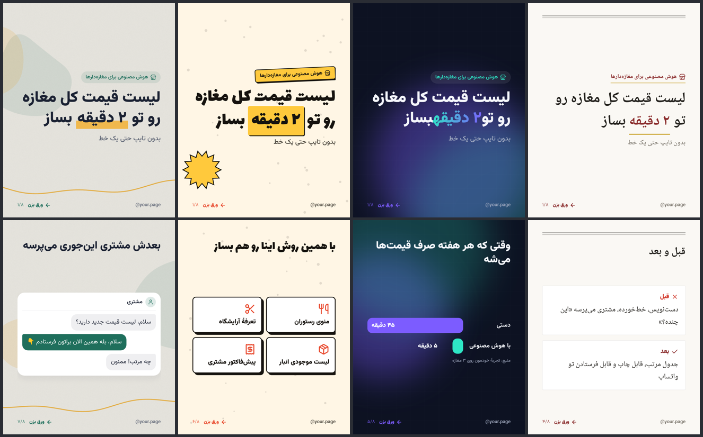
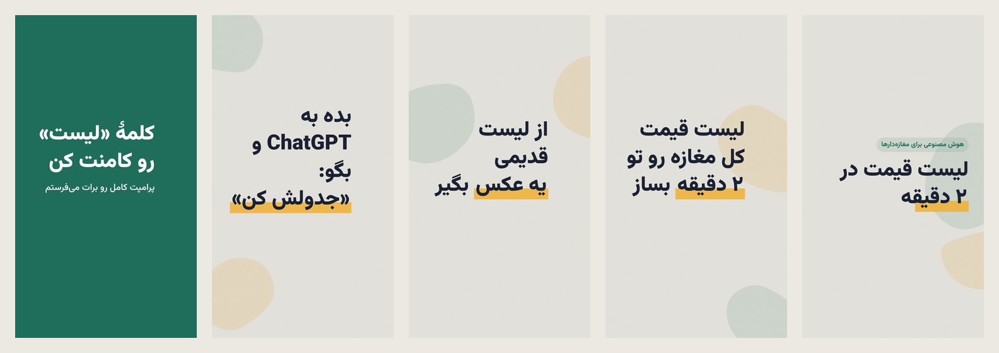

# instagram-fa — بستهٔ فارسی اینستاگرام برای Claude

سیزده اسکیل که یک پیج اینستاگرام فارسی را از صفر تا انتشار جلو می‌برند: شناسنامهٔ پیج، برنامهٔ
هفتگی با اکسل، ساختن کاروسل و استوری و ریلز با تصویر فارسی آماده، گوینده‌ی فارسی و تصویر
هوش مصنوعی رایگان، کپشن، انسانی‌ساز فارسی، و انتشار — دستی یا خودکار با API رسمی اینستاگرام.

**به هیچ موضوعی گره نخورده.** موضوع، مخاطب، لحن و رنگ‌های هر پیج در «شناسنامهٔ پیج» آن ذخیره
می‌شود؛ برای پیج دوم یا برای پیج یک نفر دیگر، فقط `ig-setup` را دوباره اجرا کن.

**انتشار به انتخاب خودت.** هر پیج دو تنظیم دارد: «حالت تأیید» (دستی: هر پست با «بله»ی تو؛
خودکار: بعد از چک‌های فنی، بدون پرسیدن) و «روش انتشار» (خودت از گوشی؛ یا خودکار با API رسمی
اینستاگرام در ساعت تعیین‌شده). پیش‌فرض هر دو دستی است.

بر پایهٔ [instagram-agent-skill](https://github.com/Jakeschincariol/instagram-agent-skill) از
Jake Schincariol (MIT)، بازنویسی‌شده برای زبان و بازار فارسی و گسترش‌یافته با تولید محتوا.

---

## سیزده اسکیل

| اسکیل | کار |
|---|---|
| `ig-setup` | ساخت و ویرایش شناسنامهٔ پیج (موضوع، مخاطب، هدف، لحن، برند، برنامه، خطوط قرمز)؛ چند پیج |
| `ig-plan` | برنامهٔ هفته: پست‌ها، ریلزها، استوری روزانه، ۱۰ پیج برای تعامل؛ **اکسل رنگی با تاریخ شمسی** |
| `ig-create` | **تولید محتوا**: از ایده یا برنامهٔ هفته تا تصویرهای ۱۰۸۰ پیکسلی فارسی و کپشن؛ تکی یا دسته‌ای |
| `ig-reel` | طراحی ریلز: ۳ قلاب امتیازدار از ۲۴ فرمول، فیلم‌نامه، بیت‌شیت، فهرست نما، کاور، ویدیو با گوینده |
| `ig-story` | استوری روزانه (پیش‌فرض حداقل ۵ قاب) با جای استیکر، تکی یا هفتگی |
| `ig-caption` | کپشن، با نمایش دقیق ۱۲۵ حرفی که فید پیش از «بیشتر» نشان می‌دهد |
| `ig-human` | انسانی‌ساز فارسی؛ کلیشه‌های متن ماشینی را برمی‌دارد و **نیم‌فاصله را حفظ می‌کند** |
| `ig-publish` | تأیید دستی یا خودکار، چک فنی، **انتشار خودکار با API رسمی** و زمان‌بند، یا پوشهٔ آماده برای انتشار دستی؛ دفتر انتشار |
| `ig-viral` | آنچه در حوزه‌ات جواب می‌دهد، با رتبهٔ «چند برابرِ میانهٔ همان پیج» |
| `ig-profile` | نمرهٔ پروفایل از ۱۰۰ و بازنویسی بایو، فیلد نام، هایلایت‌ها |
| `ig-engage` | جواب کامنت، کامنت زیر پست دیگران، دایرکت و پیشنهاد همکاری (فقط نوشتن، نه ارسال) |
| `ig-audit` | درس از آمار خود پیج؛ نتیجه‌ها در `insights.md` می‌رود و بقیهٔ اسکیل‌ها از آن می‌خوانند |
| `ig-repurpose` | یک ویدیو یا مقالهٔ بلند ← یک هفته پست مستقل |

## طراحی و ویدیو

- **چهار سبک بصری** (کاغذ و جوهر، بازارچه، شب، مجله) با رنگ‌های برند خودت؛ هر پیج یک «هویت بصری»
  دارد که همهٔ طرح‌ها از آن پیروی می‌کنند.
- **۱۸۹۱ آیکون** Lucide، **فونت‌های نمایشی فارسی** (وزیرمتن، لاله‌زار، نسخ، کوفی) و **فونت‌های خودت**.
- چیدمان‌ها: کاور، فهرست، شبکهٔ کارت، نقل‌قول، قبل/بعد، عدد بزرگ، **نمودار**، **گفت‌وگوی دایرکت**،
  **اسکرین‌شات در قاب گوشی**، پرامپت قابل‌کپی، **عکس تمام‌صفحه با متن**، استوری با جای استیکر.
- **ویدیو:** موشن‌گرافیک (ورود کلمه‌به‌کلمه، جاروی تأکید، شمارندهٔ عدد، رشد نمودار، پیام‌های متوالی)،
  تدوین کلیپ‌های خودت با متن فارسی متحرک، اسلایدشوی عکس با حرکت آرام، هماهنگ‌سازی با صدای ضبط‌شدهٔ
  خودت یا **گوینده‌ی فارسی رایگان** (هر جمله دقیقاً با تصویر خودش)، موسیقی.
- **تصویر هوش مصنوعی رایگان** در اندازهٔ دقیق پست و استوری، با برچسب رسمی «ساخته‌شده با هوش
  مصنوعی» هنگام انتشار.
- یک Chromium قابل‌حمل یک بار دانلود و در پوشهٔ کاری‌ات نگه داشته می‌شود. بدون مرورگر هم موتور
  Pillow کار می‌کند.






## ابزارهایی که واقعاً اجرا می‌شوند

| ابزار | کار |
|---|---|
| `ig-create/render.py` | ساخت تصویر از `spec.json` با سیستم طراحی (design.py) یا موتور Pillow |
| `ig-create/video.py` | ساخت ریلز: موشن، کلیپ، عکس، صدا، موسیقی؛ قابل ادامه (`--budget`) |
| `ig-create/studio.py` | کروم بی‌سر از راه DevTools Protocol، بدون کتابخانه؛ نصب Chromium قابل‌حمل |
| `ig-create/media.py` | آماده کردن عکس و فیلم گوشی (HEIC، چرخش، اندازه) |
| `ig-create/icons.py` | جست‌وجوی آیکون |
| `ig-create/tts.py` | گوینده‌ی فارسی (edge-tts طبیعی، piper آفلاین)، عدد به حروف، زمان‌بندی بیت‌ها |
| `ig-create/imagegen.py` | تصویر هوش مصنوعی رایگان (pollinations بی‌ثبت‌نام، cloudflare با حساب رایگان) |
| `ig-reel/hookscore.py`، `beats.py` | امتیاز قلاب فارسی، بیت‌شیت زمان‌دار |
| `ig-caption/caption.py` | بررسی کپشن و نمایش پنجرهٔ دید فید |
| `ig-human/humanize.py`، `detect.py` | انسانی‌ساز و پنل تشخیص متن ماشینی، مخصوص فارسی |
| `ig-viral/swipe.py` | رتبه‌بندی ریلزهای دیگران و فایل الهام |
| `ig-plan/plan_xlsx.py` | برنامهٔ هفته به اکسل راست‌به‌چپ، رنگی، قابل چاپ، با تاریخ شمسی |
| `ig-publish/publish.py` | حالت تأیید، چک فنی، انتشار، صف زمان‌بندی (`due`)، نصب زمان‌بند ویندوز (`schedule`) |
| `ig-publish/ig_api.py` | اتصال به API اینستاگرام: ورود با توکن، تمدید خودکار، سهمیه |
| `ig-publish/hosting.py` | آدرس عمومی موقت برای فایل‌ها (litterbox، cloudinary، FTP هاست خودت) |
| `ig-setup/page.py` | مدیریت پیج‌ها و پوشه‌ها |

---

## کجا اجرا می‌شود (مهم)

| کار | محیط Claude (ابری) | کامپیوتر خودت |
|---|---|---|
| شناسنامه، برنامه، متن، کپشن، طراحی تصویر، ویدیو | ✓ | ✓ |
| گوینده‌ی فارسی (edge یا piper) | ✗ | ✓ |
| تصویر هوش مصنوعی | ✗ | ✓ |
| انتشار خودکار و زمان‌بند | ✗ | ✓ (کامپیوتر در ساعت انتشار روشن) |

محیط ابری Claude فقط به چند سایت محدود دسترسی دارد و به اینستاگرام و سرویس‌های صدا و تصویر
نمی‌رسد. این بخش‌ها روی کامپیوتر خودت اجرا می‌شوند: یا Claude دسکتاپ آن‌ها را روی کامپیوترت اجرا
می‌کند (وقتی گفتگو به کامپیوترت وصل است)، یا Claude دستور دقیق را می‌دهد و خودت در cmd می‌زنی.
در ایران برای این بخش‌ها فیلترشکن لازم است.

---

## نصب

### در Claude دسکتاپ (ساده‌ترین)

فایل `instagram-fa.plugin` را در گفتگو باز کن و «نصب» را بزن. بعد پوشهٔ Documents را به گفتگو وصل کن
و بگو: «ig-setup رو اجرا کن». پیش‌نیازها (Chromium قابل‌حمل، openpyxl) را خود اسکیل آماده می‌کند.

### پیش‌نیازها برای اجرا روی سیستم خودت (Claude Code)

- **Python 3.9+**، `pip install pillow openpyxl`
- **ffmpeg** برای ویدیو — ویندوز: `winget install ffmpeg`
- اختیاری: `pip install edge-tts` یا `pip install piper-tts` برای گوینده
- برای طراحی کامل: Chrome یا Edge (یا `python skills/ig-create/studio.py setup` روی لینوکس)

### در Claude Code، به‌عنوان پلاگین

```
/plugin marketplace add hafamfamily/instagram-fa
/plugin install instagram-fa@instagram-fa
```

(اگر مخزن خصوصی است، Claude Code باید به حساب گیت‌هاب تو دسترسی داشته باشد.)

### یا کپی دستی

```bash
git clone https://github.com/hafamfamily/instagram-fa.git
```

بعد پوشه‌های `skills/ig-*` را در پوشهٔ اسکیل‌های Claude Code کپی کن:
- ویندوز: `%USERPROFILE%\.claude\skills\`
- مک و لینوکس: `~/.claude/skills/`

**همهٔ ۱۳ پوشه را کنار هم بگذار**؛ بعضی اسکیل‌ها از ابزارهای اسکیل‌های دیگر استفاده می‌کنند.

### بررسی

به Claude بگو: «ig-setup رو اجرا کن و یه پیج جدید بساز.» بار اول خودش پیش‌نیازها را بررسی
می‌کند و اگر چیزی کم بود می‌گوید.

---

## روند کار

**بار اول**

1. `ig-setup` — مصاحبهٔ کوتاه و ساخت شناسنامهٔ پیج.
2. `ig-profile` — بایو، فیلد نام و هایلایت‌ها.

**هر هفته (یک جلسه)**

1. «برنامهٔ هفته رو بچین» → `ig-plan` (+ فایل اکسل)
2. «محتوای این هفته رو بساز» → `ig-create` / `ig-reel` / `ig-story` در حالت دسته‌ای: اول همهٔ
   متن‌ها برای بازبینی، بعد تصویرها.
3. تأیید → `ig-publish`. در حالت دستی پیش‌نمایش هر محتوا و «بله»ی تو؛ در حالت خودکار بعد از
   چک‌ها بی‌سؤال. با انتشار خودکار، هر محتوا در ساعت خودش منتشر می‌شود؛ وگرنه در `ready/` با
   چک‌لیست انتشار می‌ماند.

**هر روز**

- انتشار دستی: محتوای آمادهٔ امروز را از `ready/` به گوشی بفرست و منتشر کن؛ «منتشر کردم» → ثبت.
- انتشار خودکار: کاری لازم نیست؛ «چی منتشر شد؟» → گزارش `publish.log` و ناموفق‌ها.
- ۲۰ دقیقه تعامل → `ig-engage`.

**هر ماه**

- `ig-audit` با آمار Insights، و `ig-viral` برای تازه کردن فایل الهام.

---

## پوشه‌های هر پیج

پیش‌فرض `~/instagram-fa/<نام-پیج>/` (با `page.py home` قابل تغییر، مثلاً `D:/instagram`):

```
page.md         شناسنامهٔ پیج — همهٔ اسکیل‌ها اول این را می‌خوانند
brand.json      رنگ‌ها، هندل، رقم فارسی
plan/           برنامهٔ هفته‌ها (json، md، xlsx)
content/        هر محتوا یک پوشه: spec.json، caption.txt، slides/، media/، status.json
ready/          تأییدشده‌ها، آمادهٔ انتشار، با «انتشار.md»
publish.json    حالت تأیید و روش انتشار (محرمانه نیست)
publish.log     گزارش انتشارهای خودکار
published.csv   دفتر انتشار
swipe.md        فایل الهام (ig-viral)
insights.md     درس‌های آمار (ig-audit)
```

توکن اینستاگرام و کلیدها جدا، در `<خانهٔ پیج‌ها>/.secrets/<نام پیج>.json`، فقط روی همان کامپیوتر.
این پوشه را هیچ‌وقت در گیت یا جای عمومی نگذار (`.gitignore` آن را کنار می‌گذارد).

---

## محدودیت‌ها (صادقانه)

- **انتشار خودکار فقط با API رسمی** و نیازمند یک بار راه‌اندازی است (`skills/ig-publish/API-SETUP.md`):
  حساب حرفه‌ای، اپ در Meta for Developers، توکن. این‌که متا ساخت اپ از ایران را بپذیرد از پیش معلوم
  نیست. API **استیکر** استوری و **موسیقی کتابخانهٔ اینستاگرام** را نمی‌گذارد؛ این قاب‌ها دستی می‌مانند.
- **سرویس‌های رایگان صدا و تصویر رسمی و تضمینی نیستند.** edge-tts از سرویس خواندن متن مرورگر Edge
  استفاده می‌کند و pollinations بدون ثبت‌نام محدودیت سرعت دارد؛ هر کدام ممکن است روزی عوض یا قطع
  شود. جایگزین آفلاین (piper) و حساب رایگان (cloudflare) برای همین هست. صدای piper «amir» فقط
  مجوز غیرتجاری دارد.
- **کیفیت تصویر هوش مصنوعی** به پرامپت و شانس بستگی دارد؛ هر تصویر را پیش از استفاده نگاه کن.
- **این کدها روی سرویس‌های واقعی آزمایش نشده‌اند**؛ با سرورهای شبیه‌ساز که رفتار مستند API را
  تقلید می‌کنند تست شده‌اند (`tools/mock_meta.py`). اولین انتشار واقعی را با `--dry-run` و بعد با یک
  پست کم‌اهمیت امتحان کن.
- **امتیاز قلاب و پنل انسانی‌ساز نشانه‌اند، نه پیش‌بینی بازدید.** قلاب بد را خوب جدا می‌کنند؛
  بین دو قلاب خوب، آمار واقعی پیج داور است.
- **عددهای اینستاگرام عوض می‌شوند** (پنجرهٔ ۱۲۵ حرفی کپشن، سقف ۵ هشتگ، منطقهٔ امن). اگر چیزی
  تغییر کرد، در اسکریپت‌ها یک ثابت است و راحت عوض می‌شود.

---

## تست پیش از هر نسخه

```bash
python tools/selftest.py            # ساختار، تصویر، متن، گوینده، اکسل، تأیید، انتشار و تصویر با سرور شبیه‌ساز
python tools/selftest.py --video    # همراه ساخت یک ریلز
python tools/selftest.py --sync     # بعد از تغییر skills/ig-create/fa_text.py
```

`fa_text.py` عمداً کنار پنج اسکیل تکرار شده تا هر اسکیل مستقل کار کند؛ نسخهٔ اصلی در `ig-create` است.

## تغییرات

**۱.۲.۰**
- **انتشار خودکار با API رسمی اینستاگرام**: پست، کاروسل (تا ۲۰)، ریلز (با کاور) و استوری؛ تبدیل
  خودکار به JPEG و MP4 سازگار؛ تمدید خودکار توکن؛ تلاش دوباره برای خطای موقت؛ گزارش در `publish.log`.
- **حالت تأیید دستی/خودکار** برای هر پیج؛ در هر دو حالت چک فنی (فایل‌ها، ابعاد، طول ویدیو، کپشن،
  کلمه‌های ممنوع پیج) و محتوای رد شده منتشر نمی‌شود.
- **زمان‌بند**: `publish.py schedule --apply` در Task Scheduler ویندوز (یا cron).
- **گوینده‌ی فارسی رایگان** `tts.py` (edge-tts و piper) با هماهنگی دقیق جمله‌ها و بیت‌های ریلز.
- **تصویر هوش مصنوعی رایگان** `imagegen.py` (pollinations و cloudflare).
- راهنمای فارسی `API-SETUP.md`؛ سرور شبیه‌ساز و تست‌های انتشار و تصویر.

**۱.۱.۱**
- ویدیو: مسیر نسبی `--voice` و `--music` از پوشهٔ جاری هم پیدا می‌شود (قبلاً فقط نسبت به spec).
- ویدیو: وقتی صدای راوی کوتاه‌تر از تصویر بود، انتهای ریلز (معمولاً دعوت به اقدام) بریده می‌شد؛ درست شد.
- طراحی: عبارت تأکیدی کوتاه (تا ۳ کلمه، مثل «**۲ دقیقه**») دیگر بین دو خط نمی‌شکند؛ در هر دو موتور.
- انسانی‌ساز: ۳۱ کلیشهٔ تازهٔ متن ماشینی فارسی (مثل «نقش بسیار مهمی ایفا می‌کند»، «به منظور»، «حائز اهمیت است»).
- تصویرهای نمونهٔ `docs/` و تست خودکار `tools/selftest.py` اضافه شد.

---

## مجوز و قدردانی

MIT. فونت‌ها با SIL OFL 1.1 (`skills/ig-create/fonts/LICENSES.md`)؛ آیکون‌ها از
[Lucide](https://lucide.dev) با مجوز ISC (`skills/ig-create/assets/icons/LICENSE-lucide.txt`).

- ساختار اولیه: [instagram-agent-skill](https://github.com/Jakeschincariol/instagram-agent-skill) (Jake Schincariol, MIT)
- روش «فلسفهٔ بصری» و پالت‌ها: [anthropics/skills](https://github.com/anthropics/skills) — canvas-design و theme-factory
- اصول موشن قطعی و قابل‌جست‌وجو در زمان: [remotion-dev/skills](https://github.com/remotion-dev/skills)
- Chromium قابل‌حمل: [@sparticuz/chromium](https://github.com/Sparticuz/chromium) (در زمان اجرا دانلود می‌شود)
